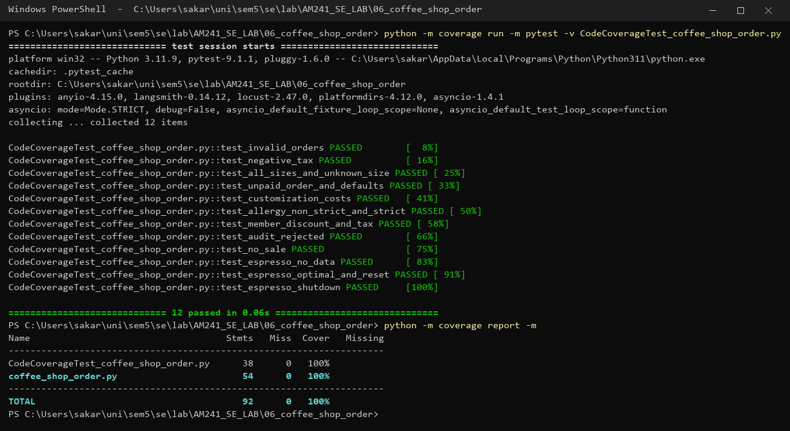
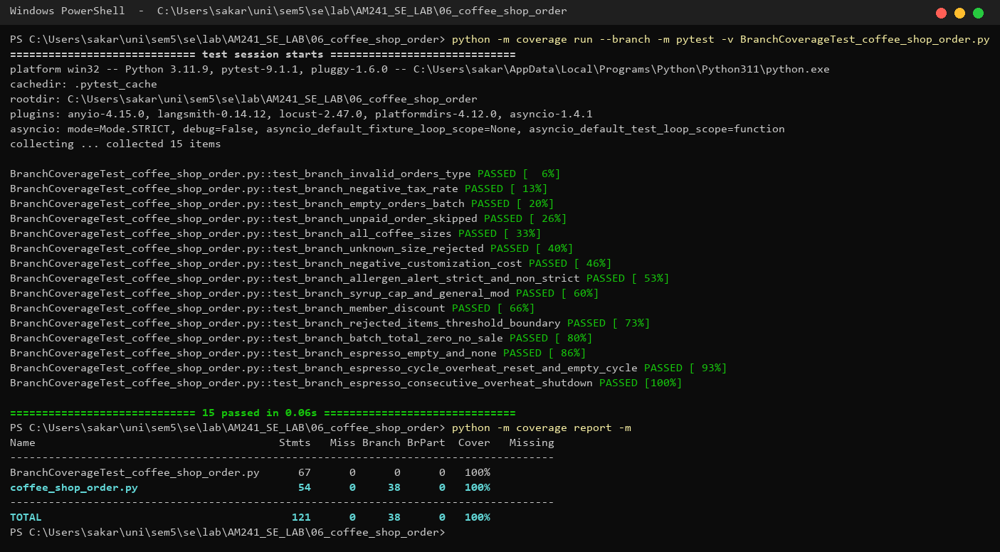

# Lab 6 — Code and Branch Coverage Analysis

**Name:** Sakaray Vishal  
**SRN:** PES1UG24AM241  
**Assigned repo:** [SETAPESU26/L6_L7_03_coffee_shop_order](https://github.com/SETAPESU26/L6_L7_03_coffee_shop_order)

## Files

| File | Description |
|------|-------------|
| `coffee_shop_order.py` | Application under test (unchanged from the assigned repo) |
| `test_coffee_shop.py` | Starter test file provided with the repo |
| `CodeCoverageTest_coffee_shop_order.py` | Test cases written for code (statement) coverage |
| `BranchCoverageTest_coffee_shop_order.py` | Test cases written for branch coverage |
| `screenshots/code_coverage.png` | Terminal output — code coverage run + report |
| `screenshots/branch_coverage.png` | Terminal output — branch coverage run + report |

## Application under test

`coffee_shop_order.py` has two functions:

- **`process_order_batch(orders, tax_rate)`** — validates input (raises `ValueError` for a non-list or negative tax), skips unpaid orders, prices by size (small 3.0 / medium 4.5 / large 6.0, unknown size is rejected), adds customizations (negative cost rejected, syrup capped at 1.5), handles allergen alerts (strict allergy zeroes the drink and stops processing it; non-strict only counts a rejection), applies a 10% member discount and tax, and returns `AUDIT_REJECTED` (more than 4 rejections), `NO_SALE` (zero total) or `COMPLETED`.
- **`check_espresso_machine(temperature_cycles)`** — returns `NO_DATA` for empty/`None` input, `SHUTDOWN` if any cycle has two consecutive readings above 96.0, otherwise `OPTIMAL`.

## Setup

```
pip install coverage pytest
```

All commands are run from this folder.

## Baseline (starter test only)

```
coverage run -m pytest test_coffee_shop.py
coverage report -m
coverage run --branch -m pytest test_coffee_shop.py
coverage report -m
```

| Metric on `coffee_shop_order.py` | Result |
|---|---|
| Line coverage | 48% (28 of 54 statements missed) |
| Branch coverage | 43% (10 partial branches out of 38) |

The single starter test only exercised one paid medium coffee with a standard add-on, so the validation error, the other sizes, syrup capping, allergen handling, member discount, the `AUDIT_REJECTED`/`NO_SALE` results and all of `check_espresso_machine` were untested.

## Code coverage

```
coverage run -m pytest -v CodeCoverageTest_coffee_shop_order.py
coverage report -m
```

12 tests, all passing. **Line coverage on `coffee_shop_order.py`: 100% (54/54 statements).**



Tests were chosen so that every statement executes at least once: invalid list and negative tax, every size plus an unknown size, an unpaid order, syrup above the cap, a normal add-on and a negative cost, strict and non-strict allergen alerts, member discount with tax, five rejections (audit), an empty batch (no sale), and the espresso checker's no-data, optimal-with-reset and shutdown paths.

## Branch coverage

```
coverage run --branch -m pytest -v BranchCoverageTest_coffee_shop_order.py
coverage report -m
```

15 tests, all passing. **Branch coverage on `coffee_shop_order.py`: 100% (38/38 branches, 0 partial).**



On top of the statement tests, these make every decision go both ways and probe boundaries:

| Decision | True side | False side / boundary |
|---|---|---|
| `not isinstance(orders, list) or tax_rate < 0` | string / `None` orders, tax −0.05 | valid list with tax ≥ 0 |
| `not order.get("paid", False)` | `paid: False` and missing `paid` key | paid orders |
| size `small` / `medium` / `large` / else | each size, default size, `extra_large` | — |
| `cost < 0` | −2.0 | 0.5 |
| `mod_type == "allergen_alert"` + `strict_allergy` | strict (total zeroed, later mods skipped) | non-strict (keeps total) |
| syrup `cost <= 1.5` | 1.0 and exactly 1.5 | 3.0 (capped) |
| `is_member` | member | non-member |
| `rejected_items > 4` | 5 rejections → `AUDIT_REJECTED` | exactly 4 → `COMPLETED` |
| `batch_total == 0.0` | strict-allergy-only batch → `NO_SALE` | non-zero total |
| `not temperature_cycles` | `[]` and `None` | non-empty input |
| inner `for temp in cycle` | readings present | empty cycle `[]` |
| `temp > 96.0` | 97.0 | exactly 96.0 (safe) |
| `overheat_streak >= 2` | two hot readings in a row → `SHUTDOWN` | single hot reading then reset |

## Line coverage vs. branch coverage

Line coverage only checks that each line ran once; branch coverage checks that every `if`/loop condition was taken both ways. The starter test shows the gap: with only "true" paths a line can be executed while its alternative is never tried. For example, the code-coverage suite reaches 100% lines without ever testing a syrup at or below the 1.5 cap, an empty inner cycle, or the "exactly 4 rejections" boundary — the branch suite adds those, so both outcomes of every decision are checked.
